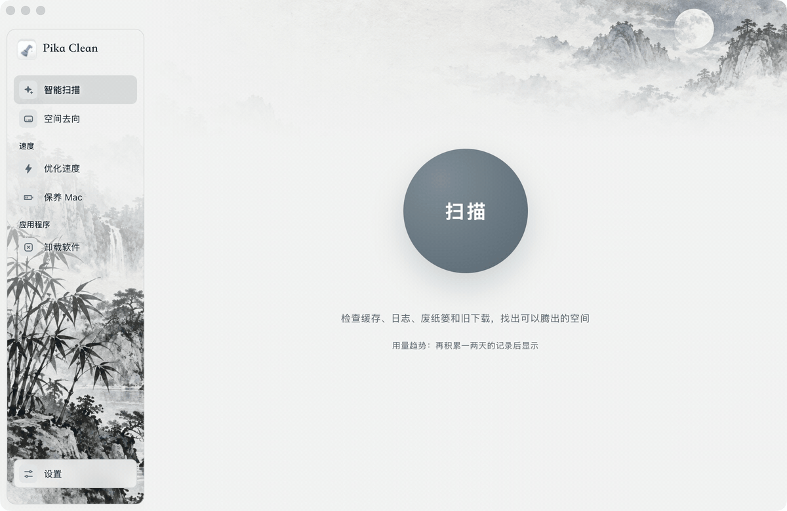

# Pika Clean

English · [简体中文](README.zh-CN.md)

An open-source Mac cleaner that tells you what a file is, and whether it's safe to delete, before you delete it.



## Features

- **Smart scan & clean**: caches, logs, Trash, old downloads, crash dumps, and browser history and cookies in one pass. Optional weekly reminder when there's a lot to clean.
- **AI explanations**: click anything you're unsure about and AI tells you what it is and what happens if you delete it. Or just say "free up space, but don't touch my downloads".
- **Uninstaller**: removes apps along with their preferences, caches, and support files. Drag an app to the Trash and it offers to clean up what was left behind. Also checks for app updates (including Homebrew) and lists browser extensions and plug-ins.
- **Speed up**: free memory, manage login items, quit resource-hungry processes.
- **Menu bar monitor**: CPU, GPU, memory, disk, network, battery, temperature, and fans. You can also show usage and network speed right in the menu bar, open the app from anywhere with ⌃⌥P, or clean caches, logs and the Trash in two clicks.
- **Developer cleanup**: Xcode, simulators, Docker, package managers, and caches from AI tools such as Claude and Cursor.
- **Space map**: see where your startup disk's space actually goes.

Available in English, 简体中文, 繁體中文, 日本語, and 한국어.

## Install

- Download the dmg from the [website](https://pika-clean.vercel.app). Runs on both Intel and Apple silicon Macs.
- Or build it yourself (see [Build from source](#build-from-source)).

The app isn't signed with an Apple Developer ID yet, so macOS blocks the first launch:

1. Drag Pika Clean into Applications and open it once.
2. When it's blocked, open **System Settings → Privacy & Security**, click **Open Anyway** at the bottom, and enter your login password. You only need to do this once.
3. If macOS says the app "is damaged and should be moved to the Trash", run this in Terminal, then open it again:

```bash
xattr -cr "/Applications/Pika Clean.app"
```

Everything is free. Optional paid services may come later (for example, AI credits that work without setting up your own key). Existing features will stay free.

## Which AI it uses

Pick one in **Settings → AI**:

- **Claude Code on this Mac**: works out of the box if Claude Code is installed and signed in, using your own quota.
- **Custom model**: any OpenAI-compatible service. If Claude Code isn't installed, the setup dialog opens the first time you use AI.

Base URLs for common services (check each provider's docs for model names):

| Service | Base URL |
|---|---|
| OpenAI | `https://api.openai.com/v1` |
| OpenRouter | `https://openrouter.ai/api/v1` |
| DeepSeek | `https://api.deepseek.com/v1` |
| Qwen (Alibaba Cloud Model Studio) | `https://dashscope.aliyuncs.com/compatible-mode/v1` |
| Kimi (Moonshot) | `https://api.moonshot.cn/v1` |
| Ollama on this Mac | `http://localhost:11434/v1` (any API key works) |

The base URL must use `https://`, except for local addresses.

## Privacy

- **Your API key is stored only in the macOS Keychain.** It's never written to a config file and isn't shown again after you save it.
- AI is called only when you click an AI feature. Nothing runs in the background against your quota.
- AI receives only paths, sizes, categories, and last-used times, or process names and usage. **File contents are never sent.** You're asked for consent before the first use, and can withdraw it in Settings.
- Every deletion needs your confirmation. Regenerable items such as caches and logs are deleted; personal files such as downloads, large files, and old projects only go to the Trash, and can be put back after cleaning.

## Build from source

Requires Xcode command line tools, Rust, and Node.js. From the repository root:

```bash
make dev        # dev mode with hot reload
make test       # all frontend and backend tests
make package    # build the .app and .dmg
```

To sign with your own certificate, put `APPLE_SIGNING_IDENTITY = ...` in a `Makefile.local` (not committed). Without it the build is ad-hoc signed and only runs on your Mac.

Developer notes (release process, backend probes, self-test) are in Chinese: see [README.zh-CN.md](README.zh-CN.md).

## Support

Pika Clean is free. If it helps you, you can sponsor it on [Afdian](https://afdian.com/a/black-robe-sanfeng). Sponsorship unlocks nothing; it helps pay for Apple code signing and ongoing development.

## License

Code is licensed under [GPLv3](LICENSE): you can use, modify, and redistribute it, but modified versions you distribute must also be GPLv3.

The "Pika Clean" name and app icon are not covered by the license. If you distribute a modified version, please use your own name and icon.

The text and images in [`website/`](website/) are all rights reserved and not covered by GPLv3.
